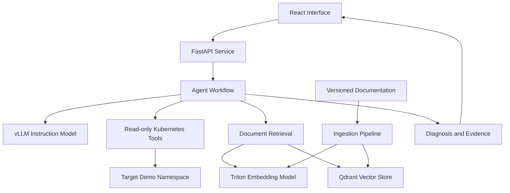

# InferOps Copilot

An agentic AI assistant for diagnosing Kubernetes deployment and inference-serving failures using runtime evidence, technical documentation, and self-hosted models.

InferOps Copilot combines a React interface, Python APIs, retrieval-augmented generation, Kubernetes diagnostic tools, vLLM, and NVIDIA Triton Inference Server.

> **Status:** Runnable local MVP. The authenticated streaming API, bounded read-only diagnostics, demo evidence, structured logs, React UI, and tests are implemented. GPU inference, vector retrieval, and production Kubernetes manifests remain optional extension paths; no performance claims are made.

## Project Checklist

### Completed

- [x] Create a React interface for submitting diagnostic questions.
- [x] Add namespace, resource kind, workload name, and runtime token inputs.
- [x] Stream diagnostic events from FastAPI using Server-Sent Events.
- [x] Validate API requests, bearer tokens, and allowed namespaces.
- [x] Provide liveness and readiness endpoints.
- [x] Add a zero-setup demo mode for local development.
- [x] Support read-only inspection of Deployments, StatefulSets, DaemonSets, Pods, and Services.
- [x] Resolve workload label selectors to matching pods.
- [x] Collect bounded pod status, restart information, events, and container logs.
- [x] Inspect Service port mappings and ready EndpointSlices.
- [x] Diagnose common OOM, image-pull, readiness-probe, port, crash-loop, and scheduling failures.
- [x] Link every diagnosis to returned evidence records.
- [x] Add structured request and tool lifecycle logs.
- [x] Add backend unit and API tests.
- [x] Add local development scripts, Dockerfiles, and setup documentation.
- [x] Verify the frontend production build and backend test suite.

### Next

- [ ] Validate the real-cluster path against each controlled failure scenario.
- [ ] Add browser-level tests for the complete UI-to-API workflow.
- [ ] Connect the workflow to a pinned instruction model served by vLLM.
- [ ] Implement Triton embeddings with matching tokenizer, pooling, and normalization settings.
- [ ] Implement document ingestion and Qdrant-backed retrieval.
- [ ] Add documentation citations to diagnostic responses.
- [ ] Complete and validate Kubernetes manifests, RBAC, probes, and Secrets.
- [ ] Add production rate limits, request timeouts, cancellation, and concurrency limits.
- [ ] Run diagnostic-quality evaluation and serving benchmarks.
- [ ] Record reproducible results in the technical report and demo guide.

The recommended next milestone is real-cluster scenario validation, followed by browser tests. Model serving and retrieval should be integrated only after the evidence workflow is stable.

## Overview

Troubleshooting Kubernetes applications often requires switching between pod logs, events, service configurations, and documentation.

InferOps Copilot brings these sources into a single diagnostic workflow.

A user asks:

> “My inference deployment keeps restarting. What is causing it?”

The assistant gathers relevant evidence, retrieves documentation, and returns:

- A likely root cause.
- Supporting logs, events, and documentation citations.
- Alternative explanations when evidence is incomplete.
- Suggested corrective actions.
- Commands the user can inspect and run.
- Follow-up checks to verify whether the problem is resolved.

The initial version uses read-only Kubernetes tools. It does not automatically modify deployments or execute generated shell commands.

## Example Diagnostic Session

**User**

```text
The inference deployment in the demo namespace keeps restarting.
Can you identify the cause?
```

**Illustrative response**

```text
Likely cause:
The container exceeded its configured memory limit.

Evidence:
- The previous container state reports OOMKilled.
- The pod has restarted multiple times.
- The deployment configuration specifies a container memory limit.

Suggested next steps:
1. Inspect memory consumption under the same workload.
2. Compare the configured limit with the application's requirements.
3. Adjust the workload or memory configuration based on those measurements.
4. Monitor restart count and container status after the change.

Limitation:
Historical memory usage was not available, so the exact peak consumption
could not be established.
```

This example illustrates the intended output format; it is not a measured project result.

## Goals

- Build an end-to-end AI troubleshooting application.
- Implement bounded agent workflows with structured tool calls.
- Ground diagnoses in Kubernetes evidence and retrieved documentation.
- Serve an instruction model through vLLM.
- Serve an embedding model through NVIDIA Triton Inference Server.
- Deploy application components as Kubernetes services.
- Design observable APIs with validation, streaming, and failure handling.
- Evaluate diagnostic quality and inference performance.
- Publish reproducible examples, a technical report, and a recorded demo.

## Technology Stack

| Technology | Intended Purpose |
|---|---|
| Python | Backend, agent workflow, ingestion, evaluation |
| FastAPI | HTTP APIs, validation, streaming, health endpoints |
| JavaScript / React | Chat interface and evidence display |
| Kubernetes Python client | Structured access to cluster resources |
| vLLM | Instruction-model inference |
| NVIDIA Triton Inference Server | Embedding-model inference |
| ONNX / ONNX Runtime backend | Initial embedding-model deployment path |
| Qdrant | Vector storage and document retrieval |
| Docker | Service packaging |
| Kubernetes | Deployment, service discovery, resource management |
| pytest | Backend and workflow tests |
| Structured JSON logs | Request tracing and debugging |

NVIDIA Triton Inference Server is distinct from the Triton GPU kernel programming language. This project uses the inference server.

Exact dependency versions and model revisions will be pinned after a working deployment is validated.

## Architecture



### Application Services

| Service | Responsibility |
|---|---|
| Frontend | Display chat, diagnostic progress, evidence, and feedback |
| Backend | Validate requests, authenticate users, coordinate diagnostics |
| vLLM | Generate tool requests and evidence-grounded answers |
| Triton | Generate document and query embeddings |
| Qdrant | Store document vectors and searchable metadata |

The agent and retrieval modules initially run inside the backend service. They can be separated later if operational requirements justify it.

### Diagnostic Workflow

1. The user submits a question and selects an allowed namespace.
2. The API validates the request and creates a request ID.
3. The agent chooses an allowed diagnostic tool.
4. The backend validates the tool arguments and executes the request.
5. Retrieved evidence is normalized into structured records.
6. Relevant documentation is retrieved using the embedding service.
7. The model produces a diagnosis with references to evidence records.
8. The frontend displays the answer, evidence, and suggested next steps.

The workflow has limits on tool calls, retries, token usage, and total execution time.

## Core Features

### 1. Diagnostic Chat Interface

Planned interface features:

- Streamed responses.
- Namespace and workload selection.
- Visible diagnostic steps.
- Expandable log and event excerpts.
- Documentation citations.
- Suggested commands with copy controls.
- Feedback on diagnostic usefulness.
- Clear indication of missing evidence or failed tools.

The interface displays observable tool activity, not hidden model reasoning.

### 2. Python API

The API provides:

- Request validation.
- Authentication.
- Namespace authorization.
- Streaming diagnostic events.
- Request IDs.
- Timeouts and cancellation.
- Rate limits and concurrency limits.
- Structured error responses.
- Health and readiness endpoints.

Initial development can use a configured bearer token. Tokens must be entered at runtime or managed through an authentication flow, rather than embedded in frontend source code.

### 3. Agent Workflow

Implement an explicit, bounded tool-execution loop.

Each tool has:

- A name and description.
- A validated input schema.
- A structured output schema.
- A timeout.
- Defined error behavior.
- A maximum output size.

The model proposes tool calls; application code validates and executes them.

If evidence is insufficient, the assistant should explain what is missing and suggest a relevant follow-up check.

### 4. Kubernetes Diagnostic Tools

| Tool | Purpose |
|---|---|
| `pod_status` | Inspect pod phase, conditions, container states, and restart counts |
| `pod_logs` | Retrieve bounded current or previous container logs |
| `pod_events` | Inspect scheduling, image-pull, probe, and restart events |
| `service_inspect` | Compare service selectors, ports, and available endpoints |
| `search_docs` | Retrieve relevant documentation passages |

Kubernetes tools use the Kubernetes API through a dedicated service account.

The initial permissions are limited to reading the resources needed for diagnosis in approved namespaces. Secret access, pod execution, and resource modification are outside the initial scope.

### 5. Retrieval-Augmented Generation

The ingestion pipeline:

1. Loads an allowlisted set of documentation sources.
2. Records source URL, title, product version, and retrieval date.
3. Extracts and normalizes text.
4. Splits documents into searchable chunks.
5. Generates embeddings through Triton.
6. Stores vectors and metadata in Qdrant.

The retrieval pipeline:

1. Embeds the user's diagnostic query.
2. Searches the document collection.
3. Applies relevant metadata filters.
4. Returns passages with stable source identifiers.
5. Supplies those passages to the agent.

Query and document embeddings must use the same model revision, pooling method, normalization, and preprocessing conventions.

### 6. vLLM Instruction-Model Serving

Use vLLM to serve a small instruction model supported by the selected deployment environment.

Model selection criteria:

- Fits available GPU memory.
- Supports the intended language and diagnostic workload.
- Supports the chosen structured-output or tool-calling approach.
- Has compatible licensing.
- Can be pinned to a specific revision.

Record:

- Model and tokenizer revision.
- Precision.
- Context limit.
- Generation settings.
- Runtime version.
- GPU model.
- Relevant serving configuration.

Tool-call parsing and chat-template behavior must be tested for the chosen model.

### 7. NVIDIA Triton Embedding Serving

The initial deployment path uses a compatible embedding model exported to ONNX and served through Triton's ONNX Runtime backend.

Planned steps:

1. Select and pin an embedding model.
2. Export the required tensor computation to ONNX.
3. Validate exported outputs against the original model.
4. Create a Triton model repository and configuration.
5. Validate input names, shapes, dtypes, and batching.
6. Compare embeddings and retrieval quality after deployment.

Tokenization initially runs in Python. The implementation must explicitly define whether pooling and normalization happen inside the exported model or in the client.

The planned model repository follows this structure:

| Path | Purpose |
|---|---|
| `model_repository/embedding/config.pbtxt` | Triton model configuration |
| `model_repository/embedding/1/model.onnx` | Versioned exported model |

The model name `embedding` is a proposed local identifier, not a pretrained model selection.

Using Triton's ONNX Runtime backend does not establish TensorRT experience. A TensorRT optimization path is an optional later experiment.

## Repository Structure

| Path | Purpose |
|---|---|
| `frontend/src/App.jsx` | Main application |
| `frontend/src/components/Chat.jsx` | Chat interaction |
| `frontend/src/components/Message.jsx` | Message rendering |
| `frontend/src/components/EvidencePanel.jsx` | Evidence and citations |
| `frontend/src/components/DiagnosticSteps.jsx` | Tool activity display |
| `frontend/src/services/api.js` | Backend client |
| `backend/app/main.py` | FastAPI application |
| `backend/app/config.py` | Validated configuration |
| `backend/app/schemas.py` | Shared request and response schemas |
| `backend/app/api/chat.py` | Diagnostic endpoint |
| `backend/app/api/health.py` | Health endpoints |
| `backend/app/api/auth.py` | Authentication |
| `backend/app/agent/workflow.py` | Bounded agent loop |
| `backend/app/agent/prompts.py` | Prompt templates |
| `backend/app/agent/tools/` | Kubernetes and retrieval tools |
| `backend/app/retrieval/` | Embeddings, vector storage, retrieval |
| `backend/app/inference/` | vLLM and Triton clients |
| `backend/tests/` | Backend correctness tests |
| `ingestion/sources.yaml` | Documentation source manifest |
| `ingestion/load_documents.py` | Document loading |
| `ingestion/chunk_documents.py` | Chunking |
| `ingestion/build_index.py` | Embedding and indexing |
| `inference/vllm/` | Model-serving configuration |
| `inference/triton/` | Embedding export and serving instructions |
| `deploy/docker/` | Container build definitions |
| `deploy/kubernetes/base/` | Kubernetes manifests |
| `scenarios/` | Controlled failure cases |
| `evaluation/datasets/cases.jsonl` | Diagnostic evaluation cases |
| `evaluation/run_evaluation.py` | Evaluation runner |
| `evaluation/metrics.py` | Metric calculation |
| `evaluation/benchmark_serving.py` | Load and latency measurements |
| `evaluation/results/` | Raw results |
| `docs/` | Architecture, tutorials, reports, and demo script |
| `scripts/` | Development and deployment helpers |

The current scaffold requires implementation before these files perform their intended functions.

## API Design

### Planned Endpoints

| Method | Endpoint | Purpose |
|---|---|---|
| `POST` | `/api/diagnose` | Start a diagnostic request and stream events |
| `GET` | `/health/live` | Check that the application process is responsive |
| `GET` | `/health/ready` | Check that required dependencies are usable |

Feedback collection can be added after the initial diagnostic flow works.

### Example Request

```json
{
  "question": "Why does this deployment keep restarting?",
  "namespace": "inferops-demo",
  "workload": {
    "kind": "Deployment",
    "name": "inference-demo"
  }
}
```

The backend checks namespace access before making Kubernetes requests.

### Streaming Protocol

The proposed endpoint uses a streaming HTTP response with Server-Sent Events formatting.

Planned event types:

- `status`
- `tool_started`
- `tool_result`
- `answer_delta`
- `completed`
- `error`

The React client reads the POST response using streaming `fetch`.

### Example Completed Result

```json
{
  "request_id": "example-request",
  "status": "completed",
  "diagnosis": {
    "summary": "The container was terminated after exceeding its memory limit.",
    "evidence_ids": ["event-1", "pod-state-1"],
    "suggested_actions": [
      "Measure memory usage under the failing workload.",
      "Review the configured memory limit."
    ],
    "limitations": [
      "Historical memory measurements were unavailable."
    ]
  }
}
```

Evidence IDs must resolve to records returned by tools or retrieval. The model must not invent citations.

## Configuration

The following variable names define the proposed configuration contract. They become functional after `config.py` and the relevant services are implemented.

```dotenv
APP_ENV=development
LOG_LEVEL=INFO
API_BEARER_TOKEN=replace-with-a-local-development-token

VLLM_BASE_URL=http://localhost:8000/v1
VLLM_MODEL=replace-with-served-model-name

TRITON_URL=localhost:8001
TRITON_MODEL_NAME=embedding
EMBEDDING_TOKENIZER=replace-with-matching-tokenizer

QDRANT_URL=http://localhost:6333
QDRANT_COLLECTION=inferops_docs

K8S_ALLOWED_NAMESPACES=inferops-demo
AGENT_MAX_TOOL_CALLS=6
AGENT_TIMEOUT_SECONDS=60
TOOL_TIMEOUT_SECONDS=10
MAX_LOG_LINES=200
```

`TRITON_URL` above represents a gRPC endpoint. Configure port mappings explicitly so Triton and vLLM do not conflict when running locally.

Keep real credentials out of version control. Use Kubernetes Secrets or an appropriate secret-management mechanism for deployed environments.

## Development Setup

### Prerequisites

Application development requires:

- Python.
- Node.js and npm.
- Docker or another compatible container runtime.
- `kubectl`.
- A local or remote Kubernetes cluster.

GPU inference requires:

- A compatible NVIDIA GPU.
- A compatible driver and inference runtime environment.
- Sufficient memory for the selected models.

Local development can use simulated model responses and Kubernetes fixtures before GPU serving is available.

### Initial Environment

From the repository root:

```bash
python3 -m venv .venv
source .venv/bin/activate
python -m pip install --upgrade pip
```

On the GPU host:

```bash
nvidia-smi
```

### Installation After Implementation

The following commands are the intended developer interface. They require completed package configuration and application code.

```bash
# Backend
python -m pip install -e './backend[dev]'

# Frontend
cd frontend
npm install
npm run dev
```

From a separate terminal at the repository root:

```bash
source .venv/bin/activate

uvicorn app.main:app \
  --app-dir backend \
  --host 127.0.0.1 \
  --port 8080 \
  --reload
```

Pin tested versions and commit the frontend lockfile after the first working installation.

## Kubernetes Deployment

The planned deployment includes:

- Frontend deployment and service.
- Backend deployment and service.
- vLLM deployment and service.
- Triton deployment and service.
- Qdrant deployment, service, and persistent storage.
- Backend service account.
- Namespace-scoped diagnostic permissions.
- ConfigMaps and Secrets.
- Liveness and readiness probes.
- CPU, memory, and GPU resource requests.

After manifests and images are implemented and validated:

```bash
kubectl apply -k deploy/kubernetes/base
```

An NVIDIA GPU-enabled Kubernetes cluster must have the required device integration configured before GPU workloads can be scheduled.

Request GPU resources explicitly. If only one GPU is available, do not assume two separate pods requesting one GPU each can run simultaneously. Begin with vLLM on the GPU and Triton embeddings on CPU if supported, or configure an explicitly supported sharing arrangement.

A Slurm GPU allocation, such as a university HPC session, is not automatically a Kubernetes cluster. It can host a permitted inference process while application development occurs elsewhere, subject to the environment's networking and usage rules.

## Controlled Failure Scenarios

Create failures only inside a dedicated demo environment.

| Scenario | Injected Problem | Expected Evidence |
|---|---|---|
| Container out of memory | Workload exceeds a deliberately small container memory limit | Previous termination reason, restart count, configured limit |
| Image pull failure | Invalid container image reference | Waiting reason and image-pull events |
| Readiness failure | Probe uses an incorrect path or port | Probe configuration and failure events |
| Service port mismatch | Service target port does not match the application | Service configuration, endpoints, application port |
| Input-length rejection | Request exceeds the server's configured input allowance | Request metadata and structured server error |

The input-length scenario is a controlled API request, not a Kubernetes resource manifest. If request evidence is unavailable to the diagnostic tools, the user or evaluation case must supply the server error.

Each scenario should document:

- Preconditions.
- How to activate the failure.
- Expected evidence.
- Root cause.
- Acceptable corrective actions.
- Cleanup procedure.

## Evaluation

### Comparison Modes

Evaluate the same model under three conditions:

| Mode | Available Context |
|---|---|
| Direct LLM | User question only |
| RAG | User question and retrieved documentation |
| Agentic RAG | User question, retrieved documentation, and diagnostic tools |

Use the same model revision and generation settings where possible.

### Dataset

Each evaluation case should include:

- Case identifier.
- Scenario type.
- User question.
- Target namespace and workload.
- Known root cause.
- Expected evidence.
- Acceptable corrective actions.
- Unacceptable or unsupported conclusions.
- Environment configuration.

Five scenario types are a starting point. Add multiple variants, healthy cases, ambiguous cases, and missing-evidence cases to avoid evaluating only memorized examples.

Keep a held-out subset that is not used for prompt tuning.

### Quality Metrics

| Metric | Measurement |
|---|---|
| Root-cause accuracy | Whether the diagnosis matches the known cause |
| Evidence correctness | Whether cited records exist and support the associated claims |
| Retrieval relevance | Whether retrieved passages help answer the diagnostic question |
| Tool-call validity | Whether tool names and arguments satisfy their schemas |
| Tool execution success | Whether valid calls complete successfully |
| Corrective-action quality | Whether suggested actions address the cause without unrelated changes |
| Unsupported-claim rate | Fraction of assessed factual claims unsupported by available evidence |
| Appropriate uncertainty | Whether the assistant acknowledges genuinely missing evidence |

Define scoring rules before evaluating. Report denominators and review subjective judgments manually.

### Performance Metrics

- End-to-end diagnostic latency.
- Time to first visible progress event.
- Time to first answer token.
- Model time to first token.
- Retrieval latency.
- Per-tool latency.
- Generated-token throughput.
- Concurrent-request success rate.
- Timeout and error rate.
- GPU memory usage.

Application time to first answer and model time to first token are different measurements because the application may perform multiple retrieval and model steps.

Report p50 and p95 latency, workload size, concurrency, and actual generated token counts.

### Proposed Evaluation Commands

These commands require the evaluation scripts to be implemented:

```bash
python -m evaluation.run_evaluation \
  --dataset evaluation/datasets/cases.jsonl \
  --mode direct \
  --output evaluation/results/direct.json

python -m evaluation.run_evaluation \
  --dataset evaluation/datasets/cases.jsonl \
  --mode rag \
  --output evaluation/results/rag.json

python -m evaluation.run_evaluation \
  --dataset evaluation/datasets/cases.jsonl \
  --mode agentic-rag \
  --output evaluation/results/agentic-rag.json
```

### Results

No results have been measured yet.

| Mode | Root-Cause Accuracy | Evidence Correctness | p95 Diagnostic Latency |
|---|---|---|---|
| Direct LLM | Not measured | Not applicable without evidence access | Not measured |
| RAG | Not measured | Not measured | Not measured |
| Agentic RAG | Not measured | Not measured | Not measured |

Publish raw results and the configuration used for every reported experiment.

## Reliability and Access Boundaries

- Authorize namespaces before running tools.
- Use structured Kubernetes API calls instead of arbitrary shell execution.
- Limit log volume, tool calls, retries, and execution time.
- Treat logs and retrieved documents as evidence rather than trusted instructions.
- Avoid returning credentials or sensitive values found in logs.
- Bound diagnostic requests and model input lengths.
- Handle unavailable model servers, retrieval failures, and Kubernetes API errors.
- Use dependency-aware readiness checks.
- Propagate request IDs through service calls.
- Keep suggested remediation separate from executable application actions.

These controls should have focused tests.

## Testing

Planned test coverage:

| Area | Tests |
|---|---|
| API | Validation, authentication, namespace authorization, streaming errors |
| Kubernetes tools | Missing resources, API errors, previous logs, output bounds |
| Retrieval | Metadata preservation, source IDs, empty results |
| Agent workflow | Tool limits, invalid calls, timeouts, missing evidence |
| Inference clients | Server errors, cancellation, malformed responses |
| Embedding export | Numerical comparison and retrieval consistency |
| Integration | One complete diagnosis against a controlled failure |

Intended test command after implementation:

```bash
python -m pytest backend/tests -q
```

Use fixtures for routine tests and a separate demo cluster for integration tests.

## Implementation Roadmap

### Milestone 1: Working Diagnostic Slice

- [ ] Implement FastAPI health and diagnostic endpoints.
- [ ] Implement pod status and event tools.
- [ ] Create one controlled failure scenario.
- [ ] Build a basic React chat interface.
- [ ] Return a structured diagnosis with evidence.

### Milestone 2: Agentic Retrieval

- [ ] Implement a bounded tool-calling workflow.
- [ ] Load and chunk versioned documentation.
- [ ] Build the Qdrant collection.
- [ ] Add retrieval with source references.
- [ ] Handle insufficient evidence and tool failures.

### Milestone 3: Self-Hosted Inference

- [ ] Deploy a pinned instruction model through vLLM.
- [ ] Validate tool-calling behavior.
- [ ] Export and validate an embedding model.
- [ ] Serve embeddings through Triton.
- [ ] Record model and runtime configurations.

### Milestone 4: Kubernetes Deployment

- [ ] Build application containers.
- [ ] Complete Kubernetes manifests.
- [ ] Configure diagnostic RBAC.
- [ ] Add health probes and resource requests.
- [ ] Document GPU placement and storage.

### Milestone 5: Evaluation and Publication

- [ ] Implement all five scenario types.
- [ ] Add held-out evaluation variants.
- [ ] Compare direct LLM, RAG, and agentic RAG.
- [ ] Measure latency and throughput.
- [ ] Write a technical report.
- [ ] Record a reproducible demonstration.
- [ ] Publish setup instructions and raw results.

## Demo Plan

A short demonstration should show:

1. A healthy deployment.
2. Activation of one controlled failure.
3. A user asking the assistant to diagnose it.
4. Visible tool activity and retrieved evidence.
5. An explanation with cited sources.
6. A human applying an appropriate fix.
7. A follow-up check confirming recovery.

Record a second case where the assistant correctly reports insufficient evidence.

## Technical Report

The report should describe:

- User problem and intended workflow.
- Architecture and deployment decisions.
- Model and inference-runtime selection.
- Evaluation dataset and scoring rules.
- Quality and performance results.
- Failure analysis.
- User-interface observations.
- Prioritized engineering improvements.
- Limitations and reproduction instructions.

Include examples where the system fails, not only successful demonstrations.

## Limitations

- Initial tools inspect a limited set of Kubernetes resources.
- Logs and events may be incomplete or expired.
- Documentation may not match every deployed version.
- Model-generated diagnoses can be incorrect.
- GPU availability limits inference throughput and model selection.
- Benchmark results apply to the documented environment.
- Automated remediation is outside the initial scope.

## Contributing

Useful contributions include:

- New diagnostic scenarios.
- Tool correctness tests.
- Retrieval evaluation cases.
- Runtime integration improvements.
- Reproduction of benchmark results.
- Documentation and user-interface improvements.

Changes to diagnostic behavior should include a representative evaluation case. Performance claims should include hardware, workload, baseline, and reproduction details.

## License

A license has not been selected.

Add a `LICENSE` file before publishing the project as licensed open source.
