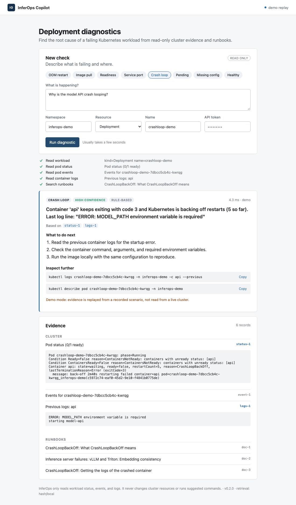
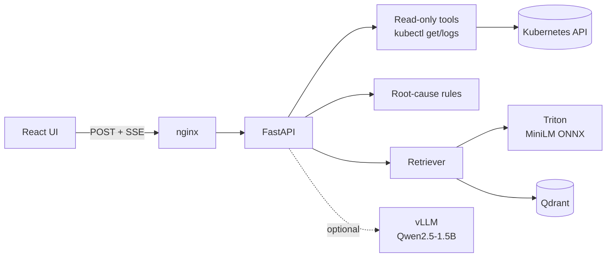

# InferOps Copilot

[](https://github.com/dhyanagni2001-commits/InferOps-Copilot/actions/workflows/ci.yml)

Evidence-grounded diagnostics for failing Kubernetes and inference-serving workloads.

Ask *"why does this deployment keep restarting?"* and InferOps reads the workload, its pods, events, and logs through a read-only service account. It classifies the root cause with deterministic rules, retrieves matching runbook passages (Triton embeddings + Qdrant), and can optionally have a vLLM-served model write the explanation. Every claim cites an evidence record the application actually collected; a model answer that cites anything else is rejected.

<p align="center"></p>

## What it detects

| Cause | Detected from | Example finding |
|---|---|---|
| `oom_killed` | `OOMKilled` in current or last state, or exit 137 under a memory limit | Container 'memory' was OOMKilled: it exceeded its memory limit (32Mi) |
| `image_pull_error` | `ErrImagePull` / `ImagePullBackOff` plus the pull event | …cannot pull image… The registry hostname does not resolve |
| `config_error` | `CreateContainerConfigError` / `CreateContainerError` | configmap "model-api-config" not found |
| `unschedulable` | `PodScheduled=False`, `FailedScheduling` | 0/1 nodes are available: 1 Insufficient cpu… |
| `liveness_probe_failure` | `Liveness probe failed` events with restarts | The kubelet keeps restarting the container |
| `crash_loop` | `CrashLoopBackOff` or a non-zero exit with restarts, plus previous logs | Exits with code 3. Last log line: "ERROR: MODEL_PATH … is required" |
| `readiness_probe_failure` | `Readiness probe failed` events on an unready pod | Running but not Ready; Services send it no traffic |
| `service_port_mismatch` | Service `targetPort` vs backing container ports | forwards 80 to targetPort 9999, but containers expose 80 |
| `service_no_endpoints` | Service selector matches no pods | selector {app: typo} matches no pods |
| `healthy` | All containers Ready with no restarts | No failure detected (transient startup warnings are noted) |
| `evidence_unavailable` / `unknown` | Workload unreadable / no rule matched | Evidence is still returned |

## What was validated

All numbers below were measured locally on 2026-10-15. Raw reports are in [`evaluation/results/`](evaluation/results/), and the method is in the [technical report](docs/technical-report.md).

| Check | Environment | Result |
|---|---|---|
| Root-cause accuracy, 8 controlled failure scenarios + missing workload | kind v0.33 / Kubernetes v1.37.0, backend in-cluster with read-only RBAC, via nginx | **9/9**; citation validity 1.0; grounded 1.0 |
| Same, demo replay of recorded cluster output | Local API | 8/8 |
| Service account cannot `delete pods`, `create deployments`, or `get secrets` | kind | verified by `kubectl auth can-i` |
| NetworkPolicy blocks non-frontend pods from the API | kind (kindnet) | verified |
| ONNX export vs PyTorch, all-MiniLM-L6-v2 @ `c9745ed` | ONNX Runtime 1.31 | min cosine 0.99999994 |
| Served path (Rust tokenizer → Triton 25.08 → embeddings) vs sentence-transformers | Triton on CPU, arm64 | min cosine 0.99999997 |
| Retrieval, 32 held-out queries: hash embeddings vs Triton MiniLM | local index and Qdrant 1.15.5 | hit@1 **0.59 → 0.91**, hit@3 0.81 → 1.00 |
| API latency, live cluster, concurrency 1 / 4 / 8 | kind, 6 vCPU | p50 103 / 129 / 259 ms; ~30 rps ceiling (4-slot limit) |

**Not validated:** vLLM generation on a GPU. The LLM path, including schema-constrained output, citation validation, and fallback, is covered only by tests against a mocked OpenAI-compatible server. The GPU overlay renders, but it has not been applied to a GPU cluster.

## Quick start

**Prerequisites:** Python 3.10+, Node 22+. For the cluster and retrieval paths, also Docker, [kind](https://kind.sigs.k8s.io/), and kubectl.

```bash
make install          # .venv and frontend dependencies
make dev              # API :8081 + UI http://localhost:5173 in demo mode, token "dev-token"
```

Demo mode replays kubectl output recorded from the real scenarios, so it needs no cluster. Pick a scenario chip in the UI and run it.

| Goal | Command |
|---|---|
| Containers, demo mode | `docker compose up --build` → http://localhost:8080 (set `UI_PORT` to change) |
| Containers + Triton + Qdrant | export the model ([guide](inference/triton/README.md)), then `EMBEDDING_BACKEND=triton USE_QDRANT=true docker compose --profile retrieval up --build` |
| Full kind run: build, deploy, break things, evaluate | `make e2e`, then `kubectl port-forward -n inferops-demo svc/inferops-frontend 18080:80` (token `kind-local-token`) |
| Your own cluster from your machine | `DEMO_MODE=false K8S_ALLOWED_NAMESPACES=<ns> make dev` with a read-only kubeconfig context |
| GPU cluster with vLLM | [GPU deployment](docs/gpu-deployment.md) |

Run `make help` to list every target.

## How it works



1. **Collect.** A fixed plan per workload kind: workload → pods (least healthy first) → events → current or previous logs. A Service is checked against its EndpointSlices and backing container ports. Calls run as argument lists (never through a shell), only `get` and `logs` are allowed, and each call is bounded by a timeout, an output cap, and a call budget.
2. **Diagnose.** Rules read only normalized cluster evidence, never documentation text. Each finding cites the records that triggered it, and secondary findings appear as alternatives.
3. **Retrieve.** Runbook passages for the detected cause come from the [`knowledge/`](knowledge/) base. Each index records its embedding model, and a mismatched index is refused.
4. **Explain (optional).** vLLM receives the evidence and rule finding and must return JSON matching a schema. Unknown evidence IDs, empty citations, malformed JSON, and timeouts all fall back to the rule-based answer, with a stated limitation.
5. **Stream.** `status`, `tool_started`, `tool_result`, `completed`, or `error` events are sent as Server-Sent Events while the work happens.

More detail, including the failure behavior of each dependency, is in [architecture](docs/architecture.md).

## API

| Method | Path | Notes |
|---|---|---|
| `POST` | `/api/diagnose` | Bearer token; namespace allowlist; SSE stream; `X-Request-ID` header |
| `GET` | `/api/config` | Non-secret runtime mode for the UI |
| `GET` | `/health/live`, `/health/ready` | Readiness fails without kubectl in cluster mode; it reports optional dependencies (vLLM, Triton, index) without failing |
| `GET` | `/metrics` | Prometheus: diagnoses by cause, latency, kubectl latency, dependency failures |

```bash
curl -N localhost:8081/api/diagnose -H 'Authorization: Bearer dev-token' -H 'Content-Type: application/json' \
  -d '{"question":"Why is it restarting?","namespace":"inferops-demo","workload":{"kind":"Deployment","name":"oom-demo"}}'
```

Safety limits: per-token rate limit, a concurrency limit, an overall deadline, cancellation on client disconnect, and validated Kubernetes names. Production refuses to start with the default token.

## Configuration

Everything is set through environment variables, validated at startup. The full list with defaults is in [`.env.example`](.env.example).

| Variable | Default | Purpose |
|---|---|---|
| `DEMO_MODE` | `true` | `false` reads the cluster with kubectl |
| `API_BEARER_TOKEN` | `dev-token` | Required token; rejected in `APP_ENV=production` |
| `K8S_ALLOWED_NAMESPACES` | `inferops-demo` | Namespace allowlist |
| `EMBEDDING_BACKEND` | `hash` | `triton` for MiniLM embeddings |
| `USE_QDRANT` | `false` | Qdrant instead of the local JSON index |
| `USE_LLM` | `false` | vLLM explanations (`VLLM_BASE_URL`, `VLLM_MODEL`) |
| `RATE_LIMIT_PER_MINUTE` / `MAX_CONCURRENT_REQUESTS` | `20` / `4` | Load limits |

## Testing

| Command | What it runs |
|---|---|
| `make lint` | Ruff on all Python |
| `make test` | 50 backend tests, including every recorded scenario, LLM fallback, auth, rate limit, timeout |
| `make test-ui` | UI build + Playwright browser tests |
| `make eval` | Scenario evaluation against a running API |
| `make eval-retrieval` | Retrieval hit@k / MRR for the local index |
| `make e2e` | kind cluster end-to-end, gated on 100% root-cause accuracy |

CI (`.github/workflows/ci.yml`) runs the backend, browser, and kind end-to-end jobs on every push and pull request.

## Project status

### Completed

- [x] Streaming diagnostic API with auth, namespace allowlist, rate and concurrency limits, deadlines, and cancellation
- [x] Read-only Kubernetes tools for Deployments, StatefulSets, DaemonSets, Pods, and Services
- [x] Rules for 11 root-cause classes, each citing the evidence that triggered it
- [x] Demo mode that replays recorded real-cluster output through the same code path
- [x] Runbook knowledge base, section-aware ingestion, local index and Qdrant
- [x] MiniLM exported to ONNX, served by Triton, numerically validated end to end
- [x] Optional vLLM explanations with schema-constrained output and citation validation
- [x] React UI with live steps, citations, commands, alternatives, dark mode, and mobile layout
- [x] Prometheus metrics, JSON logs with request IDs, real readiness checks
- [x] Non-root images, hardened Kubernetes base, NetworkPolicy, `kind` and `gpu` overlays
- [x] 8 controlled failure scenarios validated 9/9 on a live kind cluster
- [x] Evaluation, retrieval benchmark, load benchmark, and technical report with measured results
- [x] CI workflow with kind end-to-end

### Next

- [ ] Run the `gpu` overlay on a GPU node and record vLLM JSON validity, quality, and latency
- [ ] Confirm CI passes on GitHub
- [ ] Grow the retrieval query set and add upstream Kubernetes docs (`fetch: true` sources)
- [ ] Multi-user authentication behind an identity-aware proxy
- [ ] Add a license

## Repository

| Path | Contents |
|---|---|
| `backend/app/agent/` | kubectl runner and fixture replay, tools, rules, workflow, prompts |
| `backend/app/retrieval/`, `backend/app/inference/` | Embedders (hash, Triton), local and Qdrant stores, Triton and vLLM clients |
| `backend/tests/` | Backend tests |
| `frontend/` | React UI and Playwright tests |
| `knowledge/` | Runbook corpus and source manifest |
| `ingestion/` | Load → section chunking → embed → local index or Qdrant |
| `inference/triton/` | ONNX export with numerical validation, served-path validation |
| `inference/vllm/` | Pinned vLLM serve script |
| `scenarios/` | 8 controlled failures and the catalog with expected causes |
| `evaluation/` | Scenario eval, retrieval eval, load benchmark, recorded results |
| `deploy/docker/`, `docker-compose.yml` | Images (non-root, pinned kubectl) and local stack |
| `deploy/kubernetes/` | Hardened base; `kind` and `gpu` overlays |
| `scripts/` | Dev, deploy, scenarios, kind e2e, fixture capture |
| `docs/` | [Architecture](docs/architecture.md), [setup](docs/local-setup.md), [GPU deployment](docs/gpu-deployment.md), [evaluation](docs/evaluation-methodology.md), [report](docs/technical-report.md), [demo script](docs/demo-script.md) |

## Troubleshooting

| Symptom | Fix |
|---|---|
| `Bind for 0.0.0.0:8080 failed: port is already allocated` | `UI_PORT=8090 docker compose up` |
| Benchmark or eval shows HTTP 429 | The per-token rate limit; raise `RATE_LIMIT_PER_MINUTE` on the target |
| Playwright: `Executable doesn't exist` | `cd frontend && npx playwright install chromium` |
| "Documentation search unavailable: index … was built with …" | The index and `EMBEDDING_BACKEND` differ; rebuild with `python -m ingestion.build_index --embedding-backend <backend>` |
| Crash-loop finding says previous logs could not be retrieved | The runtime already garbage-collected them; check `kubectl logs --previous` soon after a restart |
| `/health/ready` returns 503 | Cluster mode without kubectl on `PATH` (or `KUBECTL_PATH`) |

## Limitations

- The plan is fixed, not model-chosen; the model only explains. That's deliberate: every kubectl call is predictable and auditable.
- Rules cover the failure classes listed above. Anything else is returned as `unknown`, with the evidence attached.
- `kubectl logs --previous` is sometimes unavailable after many restarts (containerd garbage collection). The diagnosis then says the logs could not be retrieved.
- Authentication is a single shared bearer token, which suits a single team. Multi-user setups should sit behind an identity-aware proxy.
- The retrieval evaluation set is small (32 queries written for this corpus), so treat the figures as relative, not absolute.

## License

No license yet. Add one before publishing.
